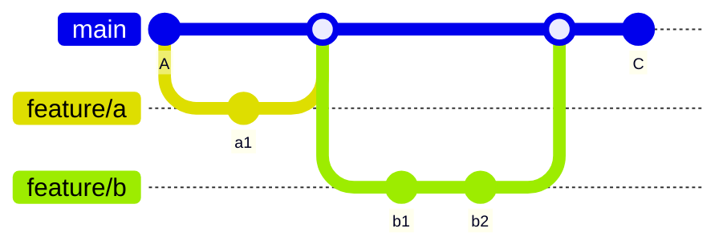

# Branching models

---
layout: default
label: 4 · Branching models
---

# Trunk-based: one main, short branches

- One long-lived branch, `main`; short branches merged back quickly
- This morning you merge on the command line; teams add a pull request on top, this afternoon

<!--
Two models in two minutes. GitFlow, which you may meet in product teams, keeps long-lived branches per release stage: main for released code, develop for integration, plus feature, release and hotfix branches. It fits software that ships numbered versions and maintains several of them at once. Trunk-based is simpler: there is just main, called the trunk. Every change is a short branch of hours or a few days that goes back into main quickly. This morning we merged on the command line. Teams put a pull request on top, so someone reviews and a pipeline checks before the merge; that is this afternoon. Main is always in a state you can use. Large teams doing continuous delivery work like this, and so do many small teams.
-->

---
layout: default
label: 4 · Branching models
---

# Use trunk-based for scripts and analyses

<DmComparison
  class="mt-2"
  :rows="['Fits', 'Cost']"
  :cols="['GitFlow', 'Trunk-based']"
>
  <template #r0c0>Versioned products, several releases in support</template>
  <template #r0c1>Continuous delivery, scripts, analyses, small teams</template>

  <template #r1c0>Many branches, large merges, more conflicts</template>
  <template #r1c1>Discipline: small changes, review, tests</template>
</DmComparison>

<ul>
  <li><b>Use trunk-based</b>: short-lived <code>feature/...</code> branches, merged into <code>main</code> often. This afternoon: pull requests and a branch policy on top</li>
  <li>Exists, not in this block: <code>git cherry-pick</code></li>
</ul>

<b>Words you can now use</b> trunk-based · GitFlow · feature branch · short-lived

<!--
The longer a branch lives, the larger the merge and the higher the chance of conflicts. GitFlow accepts that cost to support parallel releases, which analysis and tooling code rarely has. So we recommend trunk-based: small branches, pull main often, merge back quickly, delete branches after merging, and this afternoon a pull request on top. Cherry-pick copies a single commit, stash parks uncommitted edits. We name them so you recognise the words; the Pro Git book covers them. A coding assistant will pick a branching approach for you unless you say what you want, so being able to say trunk-based, short-lived feature branch and, from this afternoon, pull request, is what lets you direct it and judge the result.
-->

---
layout: statement
title: Questions - Git
---

# Questions?

The Git part

<!--
Pause here. Ask for questions on everything in the Git part: staging, commits, branches, merge, rebase, Azure Repos, pushing to a shared main and cleaning up branches. Pull requests come this afternoon. After this the day goes on with the next part. Wait a few seconds longer than feels comfortable. If nobody asks, ask one person what was least clear.
-->
